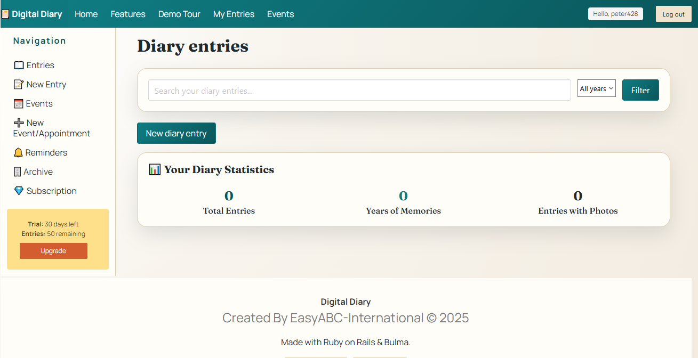
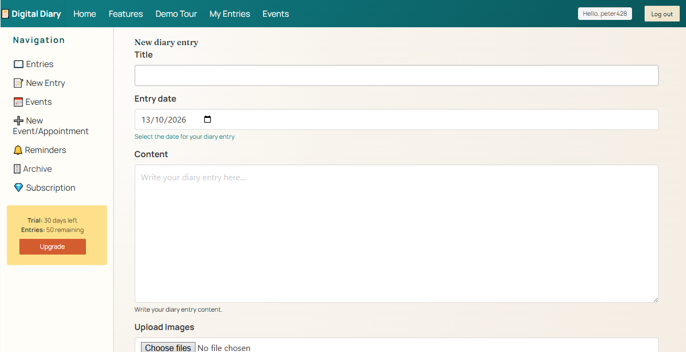
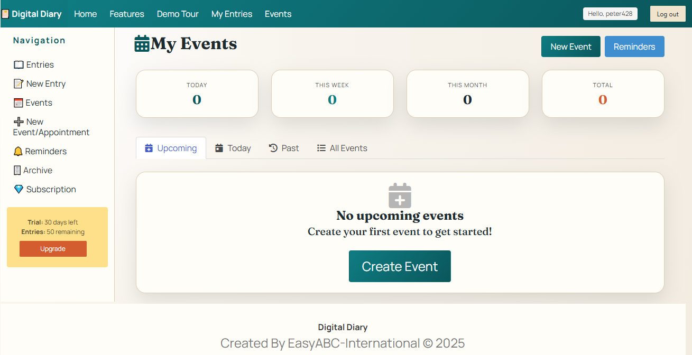

# Digital Diary — A Personal Journal for Life's Journey

**Capture your thoughts, preserve your memories, and keep your personal story in one place.**

Digital Diary is a personal journaling application designed to help you record everyday experiences, organise your thoughts, and build a lasting collection of memories.

Whether you want to write about your day, save a special moment, or look back over earlier entries, Digital Diary provides a dedicated space for your personal story.

## About the Project

Digital Diary was developed to make keeping a personal journal straightforward and accessible. It brings together daily writing, organisation, and the ability to preserve memories over time.

The project is built with Ruby on Rails and is packaged for Docker-based deployment, making it suitable for people who want to run their own diary application.
## Screenshots

Here is a look at Digital Diary in action.

### Diary Dashboard

### Creating a Diary Entry

### Events and Appointments

## Features

- **Personal diary entries** — Write, edit, and manage your journal entries.
- **Rich-text editing** — Format your writing to suit your needs.
- **Photographs and memories** — Keep images alongside your personal experiences.
- **Tags and moods** — Organise entries and record how you felt.
- **Date-based archives** — Browse earlier entries and revisit past memories.
- **Drafts and autosave** — Support your writing workflow and help preserve work in progress.
- **Thought of the Day** — Add a little inspiration to your daily journaling.
- **Progressive Web App support** — Includes features designed to support an app-like experience.
- **Help and privacy information** — Provides guidance and information about using the application.

## Technology

Digital Diary is built using:

- Ruby
- Ruby on Rails
- PostgreSQL
- Docker and Docker Compose
- Bulma CSS

The application is intended to be run using its documented setup instructions. Please consult the installation guide for the requirements and configuration applicable to your environment.

## Getting Started

### Installation

For installation instructions, Docker setup, environment configuration, and database preparation, see:

**[Read the Installation Guide](INSTALLATION.md)**

The guide should be your starting point before attempting to run the application.

### Explore the Source Code

You can browse the source code, review the project files, and follow future development here:

**[View Digital Diary on GitHub](https://github.com/pmnoos/digial_diary)**

## Who Is It For?

Digital Diary is intended for anyone who wants to keep a personal journal, record meaningful experiences, and build a collection of memories they can revisit in the years ahead.

It may be particularly useful for people who value recording their life story and preserving personal memories for themselves and future generations.

## Privacy and Personal Data

A personal diary can contain sensitive information. How your data is stored and protected depends on how the application is installed, hosted, configured, and secured.

Before storing personal or sensitive information, review your deployment configuration and ensure that your database, photographs, backups, and access credentials are appropriately protected.

## About the Developer

Digital Diary is one of Peter Magner's personal projects, developed from an interest in recording life's experiences and preserving memories.

The project reflects a simple idea: our everyday thoughts and experiences are part of our story, and they are worth keeping.

## Project Information

- **Project:** Digital Diary
- **Version:** 0.9.0
- **Repository:** [pmnoos/digial_diary](https://github.com/pmnoos/digial_diary)
- **Installation guide:** [INSTALLATION.md](INSTALLATION.md)

---

*Your life is a story worth remembering. Digital Diary gives you a place to write it down.*
